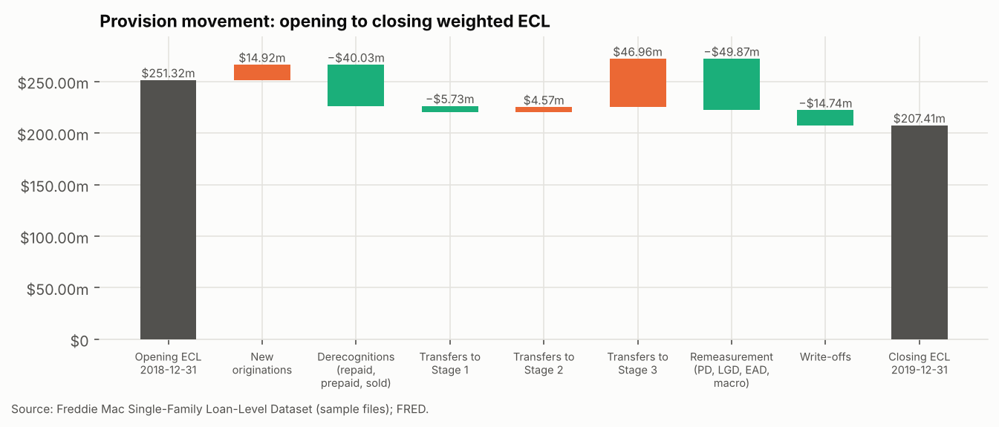
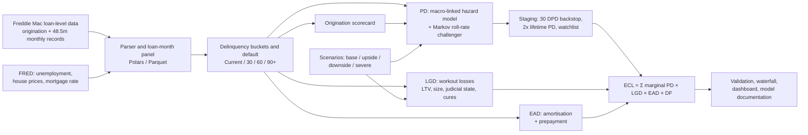
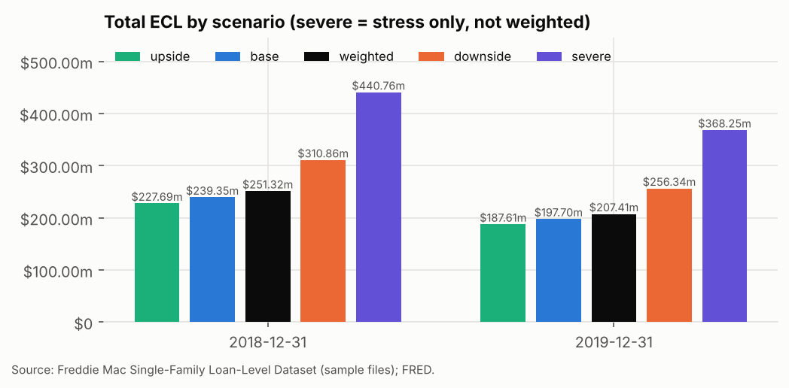
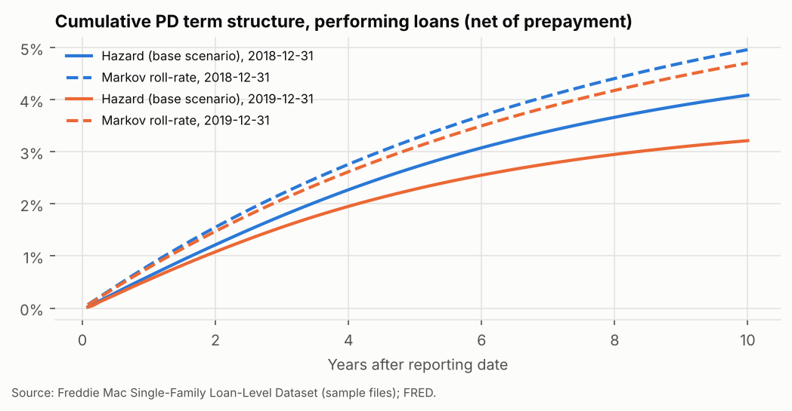
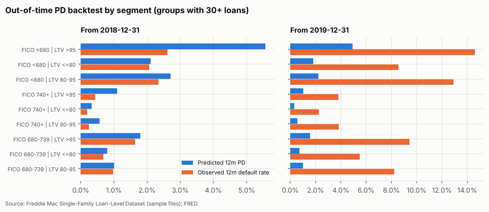
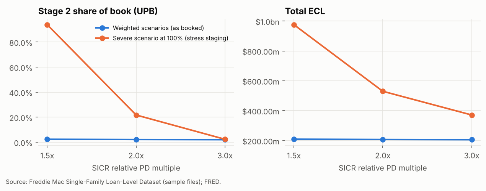
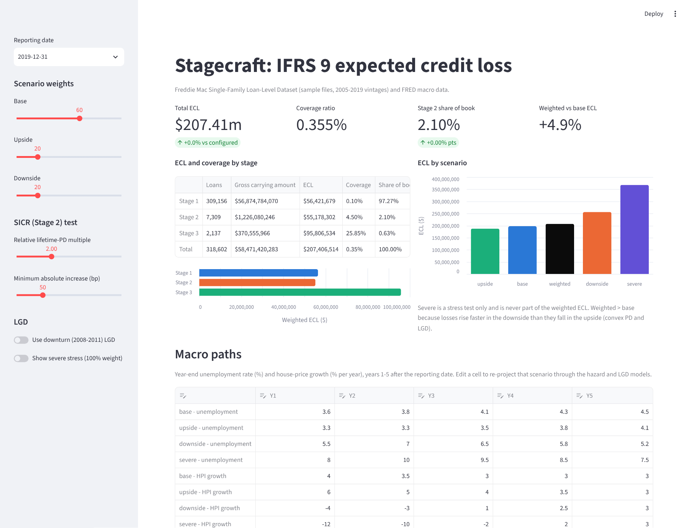

# Stagecraft — IFRS 9 Expected Credit Loss Engine

**An end-to-end IFRS 9 impairment model built on 750,000 real US mortgages (Freddie Mac, 2005–2019 vintages, 48.5 million loan-months).**
Stagecraft stages every loan, estimates 12-month and lifetime PDs with a macro-linked hazard model and a roll-rate challenger,
estimates LGD from actual foreclosure losses and EAD from amortisation and prepayment, and produces probability-weighted ECL under
base, upside and downside scenarios plus a severe stress. It explains the year-on-year change in the allowance with an IFRS 7-style
provision waterfall and validates the models out of time.

 


---

## At a glance (31 Dec 2019 portfolio)

| | |
|---|---|
| **Book** | 318,602 loans, $58.5bn gross carrying amount |
| **Probability-weighted ECL** | **$207.4m** (0.35% coverage) |
| **Stage mix (share of book / coverage)** | Stage 1 97.3% / 0.10% · Stage 2 2.1% / 4.5% · Stage 3 0.6% / 25.9% |
| **Weighted vs base ECL** | +4.9%: losses are convex in the macro drivers |
| **Severe stress (unemployment 10%, house prices −21%)** | $368m, 1.8× the booked allowance |
| **PD model discrimination (out-of-time AUC)** | 0.88 hazard vs 0.85 Markov challenger (31 Dec 2018 model, scored on 2019 outcomes) |
| **Provision movement 2018 → 2019** | $251.3m → $207.4m, reconciled loan by loan |



## What I found

1. **Probability-weighting matters, and it isn't symmetric.** The downside adds about $59m to the 2019 allowance while the upside
   removes only about $10m, so the weighted ECL sits 4.9% above the base case. PD (logistic in unemployment and LTV) and LGD (rising with
   LTV) are convex, which is exactly why IFRS 9 B5.5.42 requires multiple scenarios rather than a single "most likely" one.
2. **The PD model ranks risk very well and errs conservative in good times.** From 31 Dec 2018 it predicted a 0.68% 12-month default
   rate against 0.54% observed, with an out-of-time AUC of 0.88. The over-prediction sits in prime Stage 1 loans (0.45% vs 0.24%),
   while Stage 2 is under-predicted (9.6% vs 12.2%). Those are the two places a validator would push.
3. **COVID broke the 2019 backtest, as it broke every bank's.** Loans in forbearance were reported as missed payments, so 4.0% hit
   90+ days in 2020 against 0.60% predicted. No weighted scenario contemplated 14.8% unemployment; banks bridged that gap with
   post-model overlays. Stagecraft documents rather than hides it.
4. **The SICR "cliff effect" is latent in good times and violent in stress.** With house prices well above origination levels, moving
   the relative threshold from 3× to 1.5× barely moves the book (Stage 2 from 2.0% to 2.3%). Under stress staging, the same move
   takes Stage 2 from 22% to 94% of the book. That is the pro-cyclicality debate in one chart.
5. **Loss severity depends on more than LTV.** Across about 14,000 resolved defaults, severity averages 59% before cures.
   - **Judicial-foreclosure states:** severity is about 12 percentage points higher, because court-run foreclosures accrue more carrying cost.
   - **Loan size:** severity falls as loans get larger, because foreclosure costs are partly fixed. Without this term the LTV effect is masked.
6. **Under India's new ECL rules, the floor would bind.** Modelled Stage 1 coverage of 0.10% is below the RBI's 0.25% floor for
   individual housing loans in the 2026 ECL Directions, while Stage 2 (4.5% vs 1.5%) and Stage 3 (26% vs 10%) clear their floors.

## How it works



| Component | Approach | Code |
|---|---|---|
| **Data** | Parses Freddie Mac's pipe-delimited files, including the current release's layout changes; 15 vintages in about a minute with Polars | `load.py`, `datacheck.py` |
| **Default** | 90+ days past due (3 missed payments), REO, or a credit-event termination (foreclosure, short sale, REO, NPL sale) | `buckets.py` |
| **Origination PD** | Logistic scorecard on credit score, LTV, DTI, purpose, occupancy, channel (in-sample AUC 0.84) | `scorecard.py` |
| **PD (champion)** | Discrete-time logistic hazard on 4m loan-months. Delinquency × horizon terms let a missed payment's signal fade over time; unemployment change and house-price growth bring in the scenarios | `hazard.py` |
| **PD (challenger)** | Monthly transition matrices by FICO × LTV segment, credibility-weighted, raised to powers | `markov.py` |
| **LGD** | Economic workout LGD from Freddie's loss fields (recoveries discounted to default); fractional logit on LTV, MI, loan size, occupancy and judicial state; cure-adjusted; 2008–11 downturn table | `lgd.py` |
| **EAD** | Contractual amortisation plus deferred balance; prepayment by refinancing incentive, applied once as a competing risk | `ead.py` |
| **Staging** | Stage 3 = default plus 6-month cure probation. Stage 2 = 30 DPD, lifetime PD ≥ 2× origination and +50bp, or modified / forborne / deferred | `staging.py` |
| **ECL** | Survival-weighted marginal PD × LGD × EAD, discounted at the note rate; 12 months for Stage 1, lifetime for Stage 2, LGD × EAD for Stage 3 | `ecl.py` |
| **Scenarios** | Five-year unemployment and house-price paths built only from data published by the reporting date, then reversion to long run | `scenarios.py` |
| **Validation** | Out-of-time backtests with a binomial traffic light, AUC, calibration, stage migration, sensitivities, provision waterfall | `validation.py` |

## Results

<!-- RESULTS:START -->
| | 2018-12-31 | 2019-12-31 |
|---|---|---|
| Loans on book | 310,420 | 318,602 |
| Gross carrying amount | $56.43bn | $58.47bn |
| **Probability-weighted ECL** | **$251.32m** | **$207.41m** |
| Coverage: total | 0.445% | 0.355% |
| Stage 1: share of book / coverage | 97.0% / 0.11% | 97.3% / 0.10% |
| Stage 2: share of book / coverage | 2.3% / 6.12% | 2.1% / 4.50% |
| Stage 3: share of book / coverage | 0.7% / 28.04% | 0.6% / 25.85% |
| Base-scenario ECL | $239.35m | $197.70m |
| Weighted vs base | +5.0% | +4.9% |
| Severe stress ECL | $440.76m (1.8x) | $368.25m (1.8x) |
| 12m PD backtest: predicted vs observed | 0.68% vs 0.54% (red) | 0.60% vs 4.00% (red) |
| Out-of-time AUC (hazard / Markov) | 0.88 / 0.85 | 0.71 / 0.67 |
| Scorecard AUC (in-sample / out-of-time) | 0.84 / 0.74 | 0.84 / 0.73 |

Provision movement 2018-12-31 → 2019-12-31:

| Movement | Amount |
|---|---|
| Opening ECL 2018-12-31 | $251.32m |
| New originations | $14.92m |
| Derecognitions (repaid, prepaid, sold) | −$40.03m |
| Transfers to Stage 1 | −$5.73m |
| Transfers to Stage 2 | $4.57m |
| Transfers to Stage 3 | $46.96m |
| Remeasurement (PD, LGD, EAD, macro) | −$49.87m |
| Write-offs | −$14.74m |
| Closing ECL 2019-12-31 | $207.41m |
<!-- RESULTS:END -->

<table>
<tr><td></td><td></td></tr>
<tr><td></td><td></td></tr>
</table>

All tables are in [`outputs/`](outputs) and every chart in [`outputs/charts/`](outputs/charts). The 10-page model documentation
covers purpose, data, methodology, assumptions, results, validation, limitations and India relevance:
**[`report/model_documentation.pdf`](report/model_documentation.pdf)**.

## Interactive dashboard

Change scenario weights, the SICR threshold or the LGD basis, or edit the macro paths directly. Edited paths are re-projected
through the hazard and LGD models, and ECL and the stage mix update live.



## Run it

```bash
pip install -e ".[dev]"
pytest                                   # 20 tests: buckets, default flag, Markov rows, PD bounds, ECL horizons, discounting, waterfall, parser
streamlit run app/streamlit_app.py       # dashboard (demo mode from a fresh clone; see below)
python -m stagecraft.pipeline            # full rebuild: data -> models -> ECL -> validation -> charts -> PDF
```

**Data.** Freddie Mac's licence doesn't allow loan-level data in a public repo. To reproduce the results:
1. Register (free) at the [Single-Family Loan-Level Dataset](https://www.freddiemac.com/research/datasets/sf-loanlevel-dataset) page.
2. Download `sample_2005.zip` … `sample_2019.zip` into `data/raw/freddie/` (see [the README there](data/raw/freddie/README.md)).
3. Run `python -m stagecraft.pipeline`. The full run takes about 15 minutes on 4 cores and 16 GB of RAM.

FRED series are committed in `data/raw/macro/`. From a fresh clone, the tests and the dashboard run on a bundled synthetic sample in the
same file format (`data/sample/freddie/`, generated by `stagecraft.synth`), clearly labelled as demo data. Aggregated results,
charts and the PDF in this repo are from the real data.

## Judgment calls I own

Every assumption a model owner signs off is in [`config/assumptions.yaml`](config/assumptions.yaml), with its rationale:
- **Default definition:** 90+ days past due, or codes 02/03/09/15.
- **SICR:** a 30-day backstop; 2× lifetime PD with a 50bp floor; a watchlist.
- **Probation:** six months in Stage 3 after a cure.
- **LGD:** a 5% floor and a cure adjustment.
- **Seasoning:** loan age is not allowed to raise the hazard beyond six years.
- **Scenarios:** the paths, and 60/20/20 weights with severe used for stress only.
- **Overlay:** a placeholder, none booked.

Change one line and rerun.

## Limitations

- **Portfolio type.** US conforming mortgages are secured, amortising and house-price driven. Cards, unsecured, SME and corporate
  books need different PD drivers, CCF-based EAD and LGD models.
- **House prices.** Property values are indexed with the national HPI, so regional collapses (Nevada, Florida in 2008) are understated.
- **EIR.** The note rate is a proxy for the effective interest rate; fees aren't in the data.
- **Prepayment.** Flat prepayment rate by incentive band, with no burnout and no scenario link.
- **No management overlay.** An overlay is a governed, documented post-model adjustment for risks the model can't see, such as
  COVID forbearance in 2020. The config has a placeholder; none is booked.
- **Model history.** The origination PD is re-estimated retrospectively, and macro data is the latest revision rather than as first
  published. Section 7 of the PDF has the full list.

## India relevance

The buckets map directly onto the RBI's SMA-0/1/2 and NPA classes, and the RBI's final ECL Directions (issued 27 April 2026,
effective 1 April 2027) use the same three stages with a 30-DPD SICR presumption plus prudential floors.
[`docs/india-relevance.md`](docs/india-relevance.md) has the mapping and citations.

## Repository

```
config/assumptions.yaml   every owned assumption, commented
src/stagecraft/           load · buckets · scorecard · hazard · markov · lgd · ead · staging · ecl · scenarios ·
                          validation · report · charts · docpdf · dashboard · synth
app/                      Streamlit dashboard (+ synthetic demo bundle)
outputs/                  result tables, charts/, models/ (coefficients, matrices), headline.json
report/                   model_documentation.pdf
docs/                     data_report · case-study · interview-prep · defence · milestone-notes · india-relevance
tests/                    pytest suite
```

---

*Built by Anoushka (CS + Business, NTU; CFA Level II candidate) as a risk-analytics portfolio project. The interview companion is
[`docs/interview-prep.md`](docs/interview-prep.md).*
