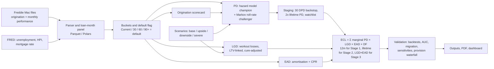

# Stagecraft

**An IFRS 9 expected credit loss engine for US mortgages.** Stagecraft stages loans, builds 12-month and lifetime PDs
from delinquency roll rates and a macro-linked hazard model, estimates LGD and EAD, and produces probability-weighted
ECL under base, upside and downside scenarios (plus a severe stress), with a provision movement waterfall like a bank's
annual report.

It is built for the **Freddie Mac Single-Family Loan-Level Dataset** sample files: about 750,000 loans from the
2005–2019 vintages, with monthly delinquency histories through the 2008 crisis and COVID. That data needs a free login and
cannot be redistributed, so the repo ships a **synthetic 12,000-loan sample in the identical file format**. Everything
below runs from a fresh clone. Drop the real files into `data/raw/freddie/` and one command regenerates every number.

## How it works



| Step | What it does | Code |
|---|---|---|
| Data | Parses the 32+32-column pipe files per Freddie Mac's layout and builds a typed loan-month panel | `load.py`, `buckets.py`, `datacheck.py` |
| Default | Status ≥ 3 missed payments (90 days), REO, or credit-event codes 02/03/09/15 | `buckets.py` |
| Origination PD | Logistic scorecard on FICO, LTV, DTI, purpose, occupancy, channel… | `scorecard.py` |
| PD (champion) | Discrete-time logistic hazard on (snapshot × horizon) loan-months, with delinquency × horizon, age, current LTV, Δunemployment, HPI growth | `hazard.py` |
| PD (challenger) | Monthly transition matrices by FICO × LTV segment, raised to powers | `markov.py` |
| LGD | Economic workout LGD from Freddie loss fields; fractional logit on current LTV; cure rate; downturn (2008–11) table | `lgd.py` |
| EAD | Contractual amortisation plus deferred UPB; SMM by refinancing incentive | `ead.py` |
| Staging | Stage 3 = default + probation; Stage 2 = 30 DPD, relative + absolute PD test, watchlist | `staging.py` |
| ECL | Survival-weighted marginal PDs, LGD and EAD paths, discounting at the note rate | `ecl.py` |
| Scenarios | Five-year unemployment/HPI paths from published data, long-run reversion | `scenarios.py` |
| Validation | Out-of-time backtests, AUC/Gini, calibration, migration, sensitivities, waterfall | `validation.py` |

## Headline results

<!-- RESULTS:START -->
> **These numbers come from the bundled synthetic sample**, not Freddie Mac loans. They show the engine
> working end to end. Run the pipeline on the real sample files to replace them.

| | 2018-12-31 | 2019-12-31 |
|---|---|---|
| Loans on book | 4,919 | 5,169 |
| Gross carrying amount | $1.11bn | $1.15bn |
| **Probability-weighted ECL** | **$1.54m** | **$1.37m** |
| Coverage: total | 0.138% | 0.119% |
| Stage 1: share of book / coverage | 97.2% / 0.04% | 97.6% / 0.04% |
| Stage 2: share of book / coverage | 1.7% / 1.79% | 1.5% / 1.61% |
| Stage 3: share of book / coverage | 1.1% / 6.06% | 0.9% / 5.99% |
| Base-scenario ECL | $1.46m | $1.30m |
| Weighted vs base | +5.3% | +5.1% |
| Severe stress ECL | $2.89m (1.9x) | $2.56m (1.9x) |
| 12m PD backtest: predicted vs observed | 0.80% vs 0.78% (green) | 0.82% vs 4.25% (red) |
| Out-of-time AUC (hazard / Markov) | 0.79 / 0.75 | 0.60 / 0.58 |
| Scorecard AUC (in-sample / out-of-time) | 0.79 / 0.61 | 0.78 / 0.57 |

Provision movement 2018-12-31 → 2019-12-31:

| Movement | Amount |
|---|---|
| Opening ECL 2018-12-31 | $1.54m |
| New originations | $0.14m |
| Derecognitions (repaid, prepaid, sold) | −$0.09m |
| Transfers to Stage 1 | −$0.01m |
| Transfers to Stage 2 | $0.01m |
| Transfers to Stage 3 | $0.49m |
| Remeasurement (PD, LGD, EAD, macro) | −$0.23m |
| Write-offs | −$0.48m |
| Closing ECL 2019-12-31 | $1.37m |
<!-- RESULTS:END -->

Charts are in [`outputs/charts/`](outputs/charts), tables in [`outputs/`](outputs), and the full write-up is in
[`report/model_documentation.pdf`](report/model_documentation.pdf).

**What the results say.** Weighted ECL is above base ECL because PD and LGD are convex in unemployment and house
prices, so the downside adds more than the upside takes away. The 2018 backtest is green overall and in every segment.
The 2019 backtest is red: the 2020 COVID shock and forbearance programmes pushed 90+ DPD rates far above anything the
scenarios contemplated. That is the case for post-model overlays. In benign years the relative SICR test rarely fires
(house prices rose, so few loans' PDs doubled), so the 30-DPD backstop and watchlist drive Stage 2 and the cliff effect
only appears under stress staging.

## Run it

```bash
pip install -e ".[dev]"
python -m stagecraft.pipeline          # data -> models -> ECL -> validation -> charts -> PDF (~1 min on the sample)
pytest                                  # 18 tests
streamlit run app/streamlit_app.py      # dashboard: weights, SICR threshold, LGD basis, editable macro paths
```

**With the real data:** download `sample_2005.zip` … `sample_2019.zip` from the
[Freddie Mac Single-Family Loan-Level Dataset](https://www.freddiemac.com/research/datasets/sf-loanlevel-dataset)
(free registration) into `data/raw/freddie/` (see [the README there](data/raw/freddie/README.md)) and rerun the pipeline.
For the full 750k-loan sample set `hazard.nonevent_sample_frac: 0.2` in `config/assumptions.yaml` to keep the hazard
training panel in memory. The FRED series (`UNRATE`, `USSTHPI`, `MORTGAGE30US`) are committed in `data/raw/macro/`, and
`stagecraft.macro.download_fred` refreshes them.

## The judgment calls are yours

Every `[RISK TO REVIEW]` assumption (default definition, SICR thresholds, watchlist, probation, LGD floor and cure
adjustment, scenario paths and weights, overlay) lives in [`config/assumptions.yaml`](config/assumptions.yaml) with a
one-line rationale. Section 4 of the PDF lists them as a table.

## Repository map

```
config/assumptions.yaml    every owned assumption, commented
src/stagecraft/            load, buckets, scorecard, markov, hazard, lgd, ead, staging, ecl, scenarios,
                           validation, report/charts/docpdf, dashboard, synth (synthetic sample generator)
app/streamlit_app.py       dashboard
data/raw/macro/            FRED CSVs        data/raw/freddie/  your Freddie Mac zips (git-ignored)
data/sample/freddie/       synthetic sample in Freddie Mac format
outputs/                   CSVs, charts/, models/, app/ (dashboard bundle), headline.json
report/                    model_documentation.pdf
docs/                      data_report, milestone-notes, case-study, defence, india-relevance
```

## Limitations

- **US mortgages are not every portfolio.** Secured, amortising, low-PD and house-price driven. Cards, unsecured, SME
  and corporate books need different PD drivers, CCF-based EAD and LGD models.
- **Sample data.** The shipped results are synthetic. The Freddie sample is conforming GSE loans only: no jumbo,
  subprime or portfolio loans.
- **Note rate as the EIR proxy.** Fees and costs aren't in the data.
- **Simplified prepayment.** Flat SMM by incentive band, with no burnout, seasonality or scenario link.
- **Collateral via national HPI only.** No regional indices or property-level revaluation; judicial vs non-judicial
  foreclosure timelines are ignored.
- **No management overlay.** An overlay is a governed, documented post-model adjustment for risks the model can't see
  (for example COVID forbearance in 2020). It is approved by committee and released when the model catches up. A
  placeholder exists in the config; none is booked.
- **Retrospective origination PD, latest-vintage macro data, overlapping hazard observations.** See section 7 of the PDF.

## India

See [`docs/india-relevance.md`](docs/india-relevance.md): how the buckets map to SMA-0/1/2 and NPA, and what the RBI's
final ECL Directions (issued 27 April 2026, effective 1 April 2027) require, with citations.
